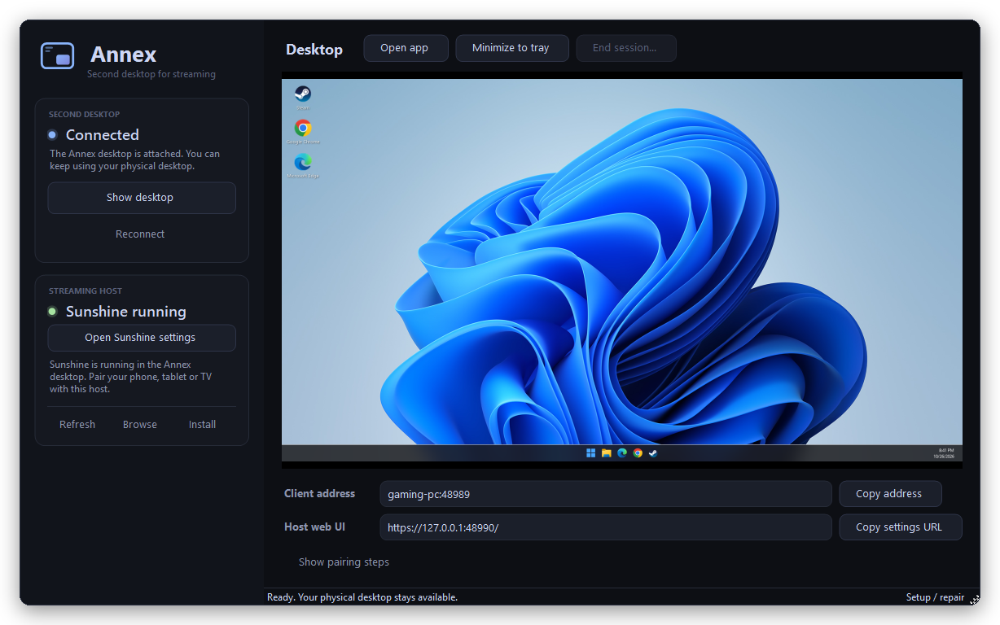
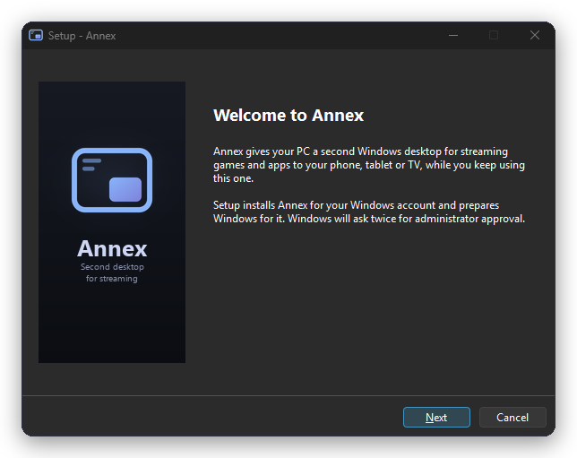
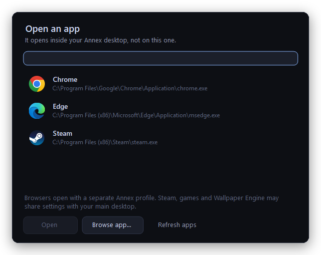

<p align="center">
  <picture>
    <source media="(prefers-color-scheme: dark)" srcset="assets/banner-dark.png">
    
  </picture>
</p>

<p align="center">
  <a href="https://github.com/mattxslv/annex/releases/latest"></a>
  
  
  
</p>

<p align="center">
  
</p>

Annex starts a second, separate Windows session on your PC (a Windows *child session*) and runs
[Sunshine](https://github.com/LizardByte/Sunshine) inside it. Moonlight or Artemis streams that desktop,
so you can play on the couch while someone else keeps using the PC, or you keep working at 144 Hz.

- No virtual display driver, no license, no account. It only uses built-in Windows features.
- Separate desktop, mouse and keyboard focus from your main session.
- Coexists with a main host like Apollo or Vibepollo, on its own ports (48989).
- Downloads and sets up portable Sunshine for you, and walks you through pairing.

## Install

1. Download **AnnexSetup.exe** from [Releases](https://github.com/mattxslv/annex/releases) and run it.
   It isn't code-signed yet, so Windows shows *Windows protected your PC*: click **More info → Run anyway**.
2. Keep **Download Sunshine** ticked. Windows asks twice for administrator approval during setup.
3. Open **Annex**, click **Start desktop** and enter your Windows password once (not your PIN).
4. Click **Start Sunshine**, then **Show pairing steps** and pair Moonlight with `your-pc:48989`.

Keep Annex open while you stream. **Minimize to tray** is fine.

<p align="center">
  
  
</p>

## Good to know

- Needs **Windows 10/11 Pro** or higher. Home doesn't have child sessions.
- **PCs with integrated and dedicated graphics:** Windows may put the Annex desktop on the integrated GPU,
  and then NVENC/AMF on your real GPU isn't used. Disable the integrated GPU in Device Manager (or BIOS)
  if you see that in Sunshine's log.
- One Annex desktop per Windows user. It uses the same account as your main desktop.
- No HDR in the Annex desktop, and the frame rate is capped by the RDP compositor (about 120 fps).
- Vibepollo can't run a second copy inside Annex. Use the Sunshine that Annex installs.
  Apollo should work but hasn't been tested yet.
- Uninstall from **Settings → Apps**. It signs out the Annex desktop and puts your Windows settings back.

## Build from source

```powershell
git clone https://github.com/mattxslv/annex
cd annex
powershell -ExecutionPolicy Bypass -File .\scripts\setup.ps1 -InstallSunshine
```

Needs only the .NET Framework compiler that ships with Windows. `scripts\test.ps1` runs the tests,
`scripts\build-installer.ps1` builds the installer (needs [Inno Setup](https://jrsoftware.org/isinfo.php)).

## Credits

- [Duo](https://github.com/DuoStream/Duo), for proving the idea.
- [ocr1n](https://github.com/ocr1n), for the launcher rework in [#2](https://github.com/mattxslv/annex/pull/2):
  host discovery, the app picker, isolated host settings and the test suite.
- [Sunshine](https://github.com/LizardByte/Sunshine), [Moonlight](https://moonlight-stream.org) and
  [Artemis](https://github.com/ClassicOldSong/moonlight-android).

MIT license. Provided as-is.
